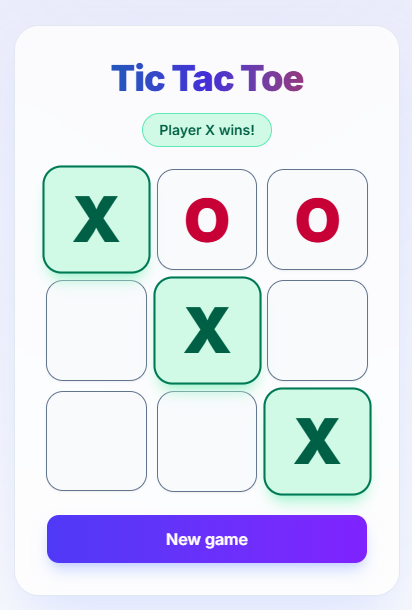

# Tic Tac Toe

A warm-up project after the summer break: a classic two-player Tic Tac Toe game built with **React**, **TypeScript** and **Tailwind CSS**.



## Features

- Two players (X and O) take turns on the same device — X always starts
- Win detection across all 8 lines, with the winning cells highlighted
- Draw detection when the board fills up with no winner
- Status pill showing whose turn it is, the winner, or a draw
- "New game" button to reset the board
- Accessible: board cells are real buttons with descriptive `aria-label`s, and the status is announced via `aria-live`
- Game logic kept as pure functions and covered by unit tests

## Tech stack

| Tool | Purpose |
| --- | --- |
| [React 19](https://react.dev/) | UI |
| [TypeScript](https://www.typescriptlang.org/) | Type safety |
| [Vite](https://vite.dev/) | Dev server and build |
| [Tailwind CSS 4](https://tailwindcss.com/) | Styling |
| [Vitest](https://vitest.dev/) | Unit tests |
| [ESLint](https://eslint.org/) | Linting |

## Getting started

Requires [Node.js](https://nodejs.org/) and npm.

```bash
npm install
npm run dev
```

Then open the URL Vite prints (usually http://localhost:5173).

## Scripts

| Command | Description |
| --- | --- |
| `npm run dev` | Start the development server |
| `npm run build` | Type-check and build for production |
| `npm run preview` | Preview the production build locally |
| `npm test` | Run the unit tests with Vitest |
| `npm run lint` | Lint the project with ESLint |

## Project structure

```
src/
├── App.tsx              # Game state, status message, reset button
├── App.types.ts         # Player and Cell types
├── components/
│   └── Board.tsx        # 3×3 grid of cell buttons
├── game/
│   ├── logic.ts         # Pure game logic (moves, winner, draw)
│   └── logic.test.ts    # Unit tests for the game logic
├── hooks/
│   └── useRenderCount.ts # Dev helper that logs component renders
├── index.css            # Tailwind and component styles
└── main.tsx             # App entry point
```

## How it works

The board is stored as an array of 9 cells (`"X"`, `"O"` or `null`). Everything else is derived from it:

- **Current player** — X starts, so it's X's turn when an even number of cells is filled, otherwise O's.
- **Winner** — `getWinner` checks the 8 possible lines (3 rows, 3 columns, 2 diagonals) and returns the player and the winning line.
- **Moves** — `playMove` returns a new board with the mark placed. Invalid moves (occupied cell, game over, out-of-range index) return the same board reference, so React skips the re-render.
